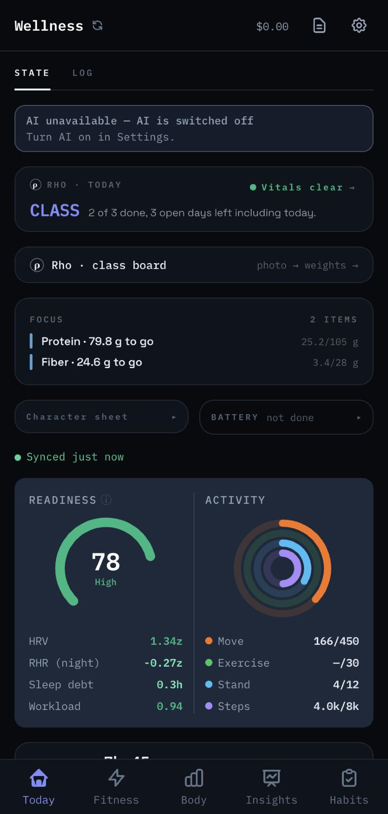
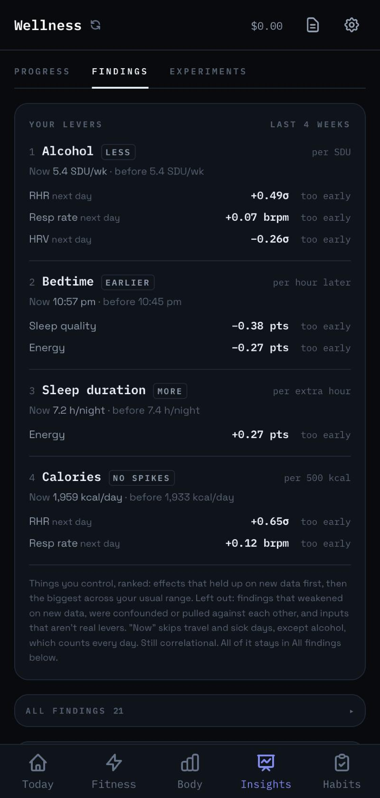

# wellness-app

A self-hosted, single-user health and training tracker. Apple Health data arrives by webhook
every couple of hours; the app turns it into recovery and training metrics, keeps a food,
drink and habit log, and runs a correlation engine that tests which behaviors actually move
which outcomes, with the statistical guard rails needed to keep it honest about a sample size
of one.

It is a personal project I use every day, not a product. The point of publishing it is the
engineering: how the numbers are measured, checked and kept from lying.

**Where to start:** [docs/ENGINEERING.md](docs/ENGINEERING.md), seven case studies (about
8 minutes). Short on time, read cases 1, 2 and 4: a model rationalising a coin flip, testing
whether a measure is reliable enough to act on, and a placebo test for confounding. The
pre-registered plan in [docs/READINESS_REFIT.md](docs/READINESS_REFIT.md) shows the same
habits applied before the data are seen, and [docs/DEMO.md](docs/DEMO.md) tests the
correlation engine against a synthetic year with known answers.

## How it was built

I designed and directed this project and wrote it with Claude Code as a pair: every commit in
the private history is co-authored. My part is the questions, the measurement design, the
decisions recorded in the code, and the checking: dry runs on a copy of the database before a
prompt change, byte-identical comparisons before a refactor ships, and pre-registered rules
written before the numbers they judge.

> **Privacy.** This is a cleaned, history-free snapshot of a private repository. It holds no
> raw records: the database, logs and notes were removed, test fixtures are synthetic, and code
> comments state findings in relative terms. The design notes cite aggregate, method-level figures (reliabilities, error
> spreads, counts) computed on the author's own data.

## What it does

- **Ingestion.** Health Auto Export (iOS) posts HealthKit samples, workouts and sleep to a
  webhook. Samples are upserted idempotently, re-exports are de-duplicated, and every day the
  data touches is recomputed in the background. Strength sets sync hourly from Hevy.
- **Recovery and training.** Overnight HRV and resting heart rate measured inside the sleep
  window, a readiness score with a visible breakdown, Banister TRIMP load and ACWR, heart-rate
  zones, heart-rate recovery measured from the end of effort, and progress against fixed
  references (the same dates a year earlier) rather than a rolling baseline that absorbs every
  real gain.
- **Nutrition.** Free-text food logging parsed by Claude into items with macros, enforced
  against the Atwater identity in code; a personal food library (My Foods) with unit
  conversions; label scans; recipes; a dynamic calorie goal from an adaptive energy model; and
  a 04:00 "food day" so a late snack belongs to the evening it was eaten.
- **Drinks, habits and exposures.** Caffeine and alcohol with on-board-at-bedtime estimates,
  fluids against a target, a habit grid with tri-state days (done, missed, not logged), and
  screen time collected from macOS.
- **Insights.** Spearman correlations with an effective-sample-size correction for
  autocorrelation, Benjamini–Hochberg FDR across the whole family of tests, negative
  controls, a reverse-lag placebo test for confounding, a prospective holdout ledger, and
  Theil–Sen / Mann–Kendall trends. Findings are ranked into a short list of levers.
- **Experiments.** Pre-registered, randomised self-experiments with eligibility rules that
  exclude sick and travel days independently of the arm.
- **Written briefings.** A daily briefing and weekly and monthly reviews generated by Claude
  from a structured context block. Cited correlations are checked against the cache, gap
  directions and run counts are computed in code and enforced on the text, and a briefing that
  comes back truncated or empty is retried once and otherwise not stored.
- **Travel.** A time-zone timeline (observed offsets plus manual periods) so days, sleep and
  scheduled jobs follow the user abroad, with a byte-identical fast path at home.
- **Offline.** A service worker and an idempotent write queue, so entries made with no signal
  replay safely when the phone reconnects.

## Architecture

```
iOS Health Auto Export ──POST /api/health/webhook──▶ ingestion
   upsert samples / workouts / sleep, record a time-zone observation
   → background recompute of daily metrics for the touched days
   → sleep arrival triggers the morning pipeline (recompute → flags → briefing)

FastAPI (~30 routers under /api) ── serves the built SPA and the service worker
SQLite (WAL mode), schema owned by Alembic
APScheduler: cron jobs that follow the user's current time zone
Anthropic API: food parsing (Haiku), briefings and reviews (Sonnet), vision reads (Opus)
ntfy: push notifications, muted on away days
React 18 · Vite · Tailwind · TanStack Query · Recharts — a PWA
```

| Path | What lives there |
|---|---|
| `backend/app/services/` | the domain logic: ingestion, metrics engine, correlations, energy model, summaries, coach, time zones |
| `backend/app/routers/` | the HTTP API |
| `backend/alembic/` | schema migrations (one baseline; see its docstring) |
| `backend/tests/unit/` | pytest suite (202 tests), run in CI |
| `backend/tests/verify_*.py` | standalone verification scripts for logic with no natural unit test |
| `frontend/src/` | the React app: Today, Fitness, Body, Insights, Habits tabs |
| `frontend/scripts/bootcheck.mjs` | loads the production bundle in happy-dom and fails on any uncaught error |
| `scripts/` | deploy with health check, smoke test and automatic rollback; the macOS screen-time collector |
| `backend/demo/` | the synthetic person, the seeder and the planted-vs-found report |
| `docs/` | design notes, the engineering case studies and the demo write-up |

## Try it on synthetic data

```bash
scripts/demo.sh        # Docker; ~1.5 min to seed, then http://localhost:8093 (owner / demo-password)
```

This builds a year of a made-up person whose causal structure is known, runs it through the
real pipeline, and scores the correlation engine against the planted effects: 7 of 8
recovered, a hidden confounder caught and labelled, and one instructive failure that the
engine's checks let through. See [docs/DEMO.md](docs/DEMO.md).

<p> </p>

## Run it

```bash
# backend (Python 3.11+)
cd backend
cp .env.example .env        # set SECRET_KEY (32+ chars), APP_PASSWORD (12+), WEBHOOK_SECRET (16+)
pip install uv && uv pip install --system -r pyproject.toml
mkdir -p data && alembic upgrade head
uvicorn app.main:app --reload --port 8093

# frontend (another terminal)
cd frontend
npm install
npm run dev                 # proxies /api to localhost:8093
```

Sign in as `owner` with `APP_PASSWORD`. The app refuses to start on a missing, default or too
short secret. Optional settings (Anthropic key, ntfy, Hevy, Home Assistant, weather
coordinates) are in `backend/app/config.py`; each feature switches itself off when its
setting is empty. A fresh install has no data; use the demo above to see it populated.

**Docker:** `docker compose up --build -d` builds the image and runs the migrations on start.
`scripts/deploy.sh` (set `DEPLOY_HOST` and `DEPLOY_PATH`) lints, tests and builds, checks that
the bundle boots, backs up the database when a migration ships, deploys, waits for the health
check, runs a smoke test over every parameter-free GET, and rolls back to the previous image
on failure.

## Tests

```bash
cd backend && python -m pytest -q tests/unit
cd frontend && npm run lint && npm test && npm run build && node scripts/bootcheck.mjs
```

CI runs both on every push. Check date logic with `TZ=UTC npm test` too: a test that passes
in the evening on a laptop can fail on a UTC runner after midnight.
