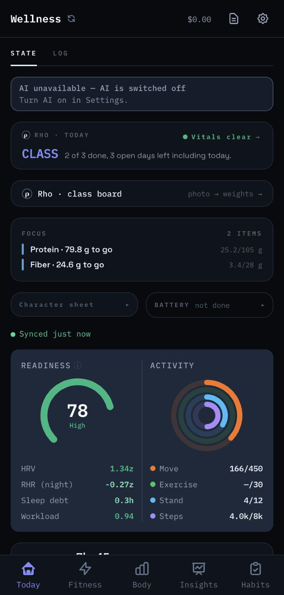
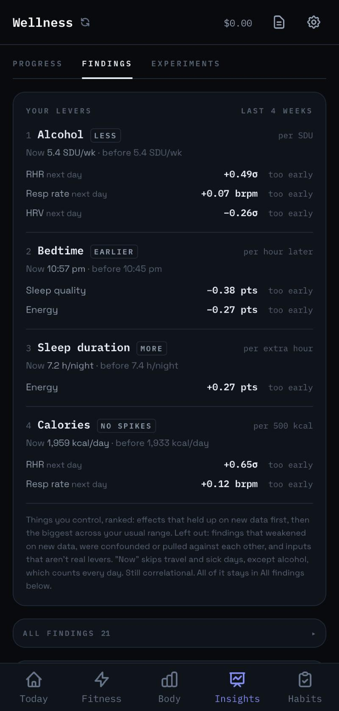

# Demo data: a synthetic year with planted ground truth

`scripts/demo.sh` builds a database for a made-up user and serves the app on it. Sign in as
`owner` with password `demo-password`. It needs Docker, and Node 20+ only if the frontend has
not been built.

 

## How it is built

`backend/demo/model.py` generates a year of a synthetic person from a small causal model:
sleep, overnight heart rate, HRV, breathing rate, workouts with second-by-second heart rate,
steps, food, caffeine, alcohol, water, habits, morning check-ins, one trip abroad and one
illness. `backend/demo/seed.py` sends it through the same code production uses: the webhook's
ingestion functions, the intake services, the daily-metric recompute, the post-trip recovery
flags, the correlation refresh and the game. Nothing is written into a derived table by hand,
so every chart and finding comes from the real pipeline.

**The one design rule:** every behaviour is drawn independently of every other behaviour and
of every outcome, except where an effect is planted on purpose. That makes the engine's
output scoreable. Each surviving finding is either a planted effect, one of the deliberate
traps, a known side effect of how the world is built, or a false positive.

## What was planted

| Effect | Size in the generator |
|---|---|
| Drinks → higher overnight heart rate the next night | +1.0 bpm per standard drink |
| Drinks → lower overnight HRV | −4% per drink |
| Drinks → higher sleeping breathing rate | +0.08 breaths/min per drink |
| A hard class → lower HRV the next morning | about −7% |
| A hard class → higher overnight heart rate | +0.3 bpm (deliberately too small to detect) |
| More sleep → more energy the same morning | +0.30 points (1–5) per hour |
| More sleep → better rated sleep | +0.40 points per hour |
| Caffeine on board at bedtime → worse rated sleep | −0.3 points per 50 mg |

**Two traps:**
- **A hidden confounder.** Stressful weeks raise caffeine and lower mood (and raise stress).
  Caffeine has no effect on either.
- **Reverse causation.** Morning energy drives that day's steps, and energy carries over from
  day to day. Steps have no effect on energy.

## What the engine found

`backend/demo/report.py` scores the engine's surviving findings against that table. One run
([full report](demo-report.md)), 425 pairs tested:

- **7 of 8 planted effects recovered**, all with the right sign, most on several inputs that
  measure the same cause. The lever card even recovers sizes: breathing rate +0.07 per drink
  against the +0.08 planted.
- **The missed one is the deliberately small effect** (+0.3 bpm). Its best pair tested at
  ρ +0.10.
- **The stress confounder: 6 surviving pairs, all labelled CONFOUNDED** by the reverse-lag
  test, so none can become a recommendation.
- **The reverse-causation trap produced no surviving pair at all.** Energy's day-to-day
  carry-over was not strong enough to make steps look like a cause.
- **No negative control survived**, and no planted pair came out with the wrong sign.
- **4 false positives**, all at the weaker "suggestive" tier. One is a 7-day rolling input,
  a known source of spurious correlation that the app already marks as not testable for
  reverse lag.

## The finding worth discussing

**4 more survivors are the instructive failure: calories → next-night heart rate, breathing
rate and HRV.** Drinks are logged as food too, so on drinking days calories rise with the
alcohol. Food has no effect on anything in this world. These are confounding by same-day
co-occurrence, and the reverse-lag test cannot catch them: drinking does not persist from one
day to the next, so the reverse correlation is near zero and the pair passes.

They do not stay hidden in a list. **Calories appears as lever #4 on the Findings card**
(screenshot above), recommending "no spikes" to lower heart rate. Every check the app has
passed it.

The fix this points to is to test a candidate lever conditional on its strongest co-occurring
input (here, calories given alcohol) before ranking it. That has not been built.

## Caveats

- **The same person built the engine and the world.** The effect sizes and the structure were
  chosen knowing how the engine works. This is a sanity check that the pipeline recovers
  known effects end to end, not an independent validation of the method.
- **The numbers move slightly with the build date.** The year always ends today, so the
  weekday pattern of the schedule shifts against the calendar. The random draws are fixed.
- **Not in the demo:** strength sets from Hevy, blood panels, class boards, TV and console
  time, screen time, reaction-time tests, weather and AI-written briefings. The app needs no
  API key to run on it, and AI features show as switched off.
